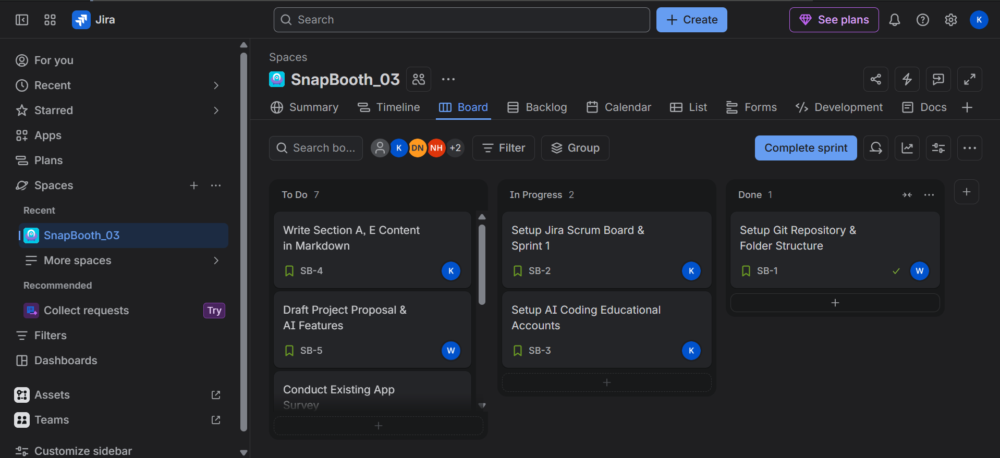
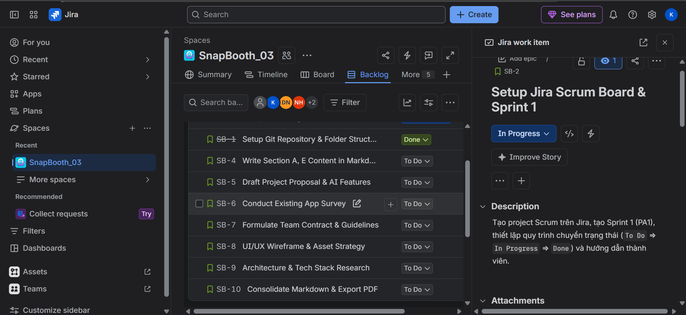
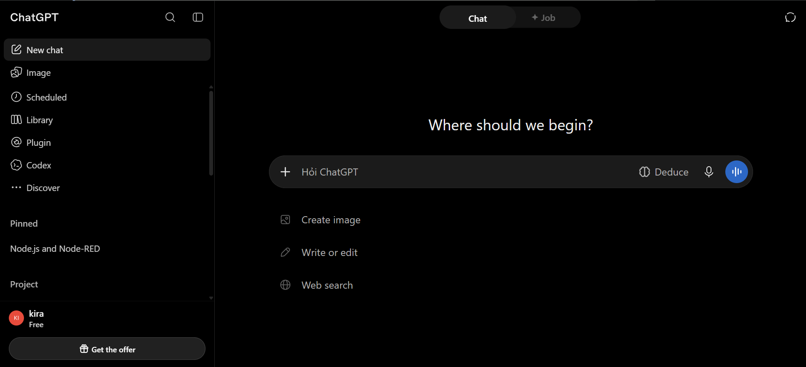

# E. Development Tools and Process Setup
*Performed by: Pham Lam Quyen | Reviewed by: Nguyen Minh Hoang | Edited by: Pham Lam Quyen*

## 1. Development Process (Scrum Methodology)

Our team adopts the Scrum framework to manage the SnapBooth project. Each Project Assignment (PA) corresponds to one Sprint spanning 2–3 weeks.

- **Sprint 1 (PA1) Goal:** Setup project infrastructure, finalize the project proposal, conduct market research on existing apps, and establish collaboration workflows.
- **Scrum Meetings:**
  - **Sprint Planning:** Conducted at the start of Sprint 1 to define tasks (SB-1 to SB-10) and assign single owners.
  - **Daily Scrum (2 sessions):** Held mid-sprint to review progress on Markdown documentation and resolve blockers.
  - **Sprint Review & Retrospective:** Scheduled before submission to review deliverables and evaluate teamwork efficiency.

## 2. Tools & Environment Setup

We have configured the following tools for seamless team collaboration:

- **Moodle and Discord channel `#snapbooth-dev`:** Used for tracking official course announcements and submissions.
- **Communication Tool:**Box messenger `SE02` created for daily interactions and quick technical discussions.
- **Task Management (Jira):** Configured a Scrum board at `phamlamquyen1707.atlassian.net`. Every sub-task (SB-1 to SB-10) is strictly assigned to exactly one member with recorded creation, assignment, and completion dates.
- **Version Control (Git & GitHub):** Private repository initialized with standard folder structures (`/src`, `/docs`, `/docs/management`, etc.). API keys are protected using `.gitignore`.
- **AI Coding Platforms:** All 5 team members have registered for educational AI coding accounts.
- **Spec Kit Adoption Plan:** The team is prepared to adopt Spec Kit starting from PA2 for specification-driven development.

## 3. Jira Task Management Evidence

The following screenshots provide evidence of our Jira Scrum Board and backlog, including all ten tasks (SB-1 to SB-10).

### 3.1. Scrum Board



*SnapBooth Sprint 1 Scrum Board showing task distribution across To Do, In Progress, and Done.*

### 3.2. Backlog - Tasks SB-1 to SB-10




*Jira backlog showing the group of tasks, from SB-1 to SB-10.*

## 4. Git Repository Structure & Commit Log

The private repository layout follows the required course standards:

```text
SnapBooth/
├── src/
├── docs/
│   ├── management/
│   │   ├── PA1-GroupXX.md
│   │   ├── images/
│   │   └── weekly-reports/
│   ├── requirements/
│   ├── analysis-and-design/
│   └── test/
└── .gitignore
```

## 5. AI Coding Accounts Evidence

Each team member is required to register for a free educational account on an AI coding platform, such as GitHub Copilot for Students or Cursor or etc.., in accordance with the course curriculum. The following screenshots provide evidence of account registration for all five team members.

### 5.1. Hoang


### 5.2. Tung


### 5.3. Quyen


### 5.4. Duy


### 5.5. Minh
