# PA1-2026 — SnapBooth

**CS300 / CSC13002 — Introduction to Software Engineering**\
**Project Assignment 1 (PA1-2026)**\
**Team:** Group 03\
**Project:** SnapBooth

---

## Contents

- [A - Group Registration](#a---group-registration)
- [B - Project Proposal](#b---project-proposal)
- [C - Existing App Survey](#c---existing-app-survey)
- [D - Team Contract](#d---team-contract)
- [E - Development Tools and Process Setup](#e---development-tools-and-process-setup)

---

## A - Group Registration

**Project Name:** SnapBooth\
**Group Name:** Group 03\
**Group Leader:** Phạm Nguyễn Thanh Tùng

| Member | Full Name | Student ID |
|---|---|---|
| Member 1 | Phạm Nguyễn Thanh Tùng | 24127260 |
| Member 2 | Nguyễn Minh Hoàng | 24127172 |
| Member 3 | Phạm Lâm Quyền | 24127116 |
| Member 4 | Phan Ngọc Duy | 24127354 |
| Member 5 | Trần Quang Minh | 24127452 |

---

## B - Project Proposal

**Performed by:** Phạm Nguyễn Thanh Tùng | **Reviewed by:** All members | **Edited by:** Trần Quang Minh, Phạm Nguyễn Thanh Tùng

### 1. Introduction

SnapBooth is a web-based photobooth application designed for events such as weddings, birthdays, and corporate gatherings. It replicates the photobooth experience while making it more accessible to users. With a QR code invitation mechanism, users can host a photobooth section and invite others to capture, apply edits and contribute their moments to a shared event album.

### 2. Target Users and Environments

-   Hosts (Event Organizers): Couples, corporate event planners, or individuals organizing private parties who need a centralized way to collect photos from guests.

-   Guests (Attendees): Friends, family, or colleagues attending the event who want to take fun, themed photos without creating an account.

-   Admins (System Administrators): Platform owners who moderate content and manage the system.

-   Environments: SnapBooth is a web application accessible across multiple environments. It supports modern web browsers (Chrome, Safari, Edge, Firefox) on desktop, tablet, and mobile devices (iOS and Android). Since it utilizes the device's camera, an internet connection and a browser with camera permission enabled are required.

### 3. Key Features (10 Functional Groups)

#### 3.1. Authentication & Account

This group handles secure access for Hosts and Admins, including sign-up, log-in, password reset, and profileupdates. Additionally, it supports a frictionless "Guest Mode" where attendees can join events without creating an account, ensuring a smooth user experience during the event.

#### 3.2. Photobooth Session & Event Management

Hosts can create and configure event sessions by setting parameters like countdown timers, default layouts, and privacy modes. This group also includes generating unique QR codes for guests to join and closing the event when it ends, giving the Host full control over the event's lifecycle.

#### 3.3. Guest Join & Access

This feature allows Guests to join an event quickly by scanning a QR code or entering a short event code. It supports anonymous joining or setting a temporary display name. This reduces onboarding friction, ensuring guests can start taking photos within seconds of opening the link.

#### 3.4. Camera Capture

Leveraging the device's webcam, this group provides a live preview, a customizable countdown (3s, 5s, 10s), and a capture mechanism. It supports single shots, burst captures for multi-photo layouts, retake options, and a mirror mode, replicating the physical photobooth experience directly in the browser.

#### 3.5. Layout & Frame Selection

Users can choose how their final images are composed, selecting from layouts like single photos, 2x2 grids, or 4-photo strips. They can also apply themed frames (e.g., wedding, birthday, Tet) to decorate their photos. This adds a layer of personalization and fun to the final output.

#### 3.6. Photo Editor

After capturing, users are directed to an interactive canvas editor where they can apply color filters, add text, draw freely, and place stickers. Notably, stickers can be dragged, resized, and rotated. This feature transforms basic camera shots into polished, shareable digital memories.

#### 3.7. Sticker & Asset Management

This group manages the library of stickers, frames, and filters available in the editor. Users can browse categorized assets or upload their own personal stickers. The system tags these assets with metadata (theme, mood, color) which serves as the foundational data for the AI feature.

**Note:** If the uploaded stickers or any assets don't belong to a specific tag, users can tag them as "Others". However, AI advisors won't be able to recommend stickers or assets within this segment due to the lack of contextual meaning.

#### 3.8. Event Album & Gallery

All captured photos are automatically aggregated into a centralized, shared event album. Hosts and Guests can view the gallery, apply filters, and mark favorites. Hosts have the exclusive ability to moderate the album (approve or reject photos).

#### 3.9. Sharing & Download

Users can download their photos in high
resolution (JPG/PNG) or generate a shareable link. The link enables
others to view and download the host's event album to share them on
other media platforms such as Facebook and Zalo.

#### 3.10. Admin & Moderation

The Admin dashboard provides system-wide oversight. Admins can manage user accounts (ban/unban), review reported content, delete violating photos, and view platform-wide analytics. This ensures the platform remains safe, ethical, and compliant with regulations.

### 4. AI Feature: AI Concept Advisor

SnapBooth features an AI Concept Advisor, an intent-driven
recommendation system designed to help users overcome "design paralysis"
and create professional-looking photos effortlessly. Instead of building
a generic, token-heavy chatbot, we designed a cost-effective, hybrid AI
pipeline.

**How it works:** When a user inputs a short description (e.g., "Outdoor
vintage wedding"), the system runs a Single-Shot Intent Extraction
pipeline:

**AI Extraction:** A lightweight LLM (via Groq API) extracts structured
JSON tags (e.g., occasion, style) in just one API call.

**Backend Query & Scoring:** The backend queries the PostgreSQL database and uses a custom rule-based scoring engine to rank frames, filters, and stickers based on tag matches.

**Interactive UI:** The system returns the best-matched concept along
with the extracted tags, which the frontend displays as interactive
buttons for users to easily swap or refine assets without calling the AI
again.

**Why it enhances the user experience:** Instead of scrolling through hundreds of assets, users get a personalized, context-aware recommendation in seconds. More importantly, because the tags are interactive, users can click on a tag (e.g., "vintage") to instantly view and swap assets within that specific category, or remove a tag to refine the results---all without triggering another AI request.

**Why this is a meaningful AI feature (and not a simple wrapper):** This feature relies on natural language understanding to map human descriptions to system metadata, which simple keyword search cannot
achieve. Unlike typical AI projects that waste tokens on multi-turn chat, our architecture limits the AI to a single, lightweight extraction step. The heavy lifting is handled by our backend logic (tagging system, database querying, and scoring engine). This demonstrates strong software engineering skills while keeping API costs near zero.

---

## C - Existing App Survey

**Performed by:** Phan Ngọc Duy | **Reviewed by:** Phạm Nguyễn Thanh Tùng | **Edited by:** Phan Ngọc Duy

To thoroughly understand the existing market solutions, user interface patterns, and workflow designs before building **SnapBooth**, our team surveyed representative web-based photobooth applications and QR-based event album platforms.

### 1 Surveyed Applications and User Flows

#### 1.1. PhotoXinhh by FreeHiHi (`https://photo.freehihi.com`)

**Overview:** PhotoXinhh is a modern browser-based online photobooth application that enables users to capture instant multi-shot photo strips directly from desktop or mobile web browsers without installing native software, creating accounts, or adding watermarks.

* **Screen 1: Landing Page & Primary Call-to-Action**
 
  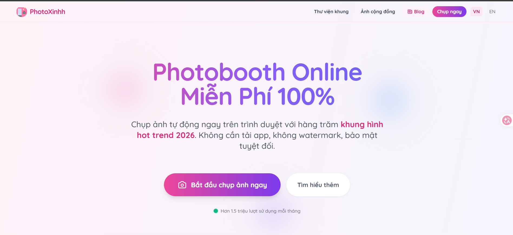
 
  * **Caption:** The landing screen introduces the core value proposition of an automated, free browser-based photobooth. A prominent "Bắt đầu chụp ảnh ngay" (Start Camera Now) button provides immediate access to the studio without any registration wall.

* **Screen 2: Browser Camera Permission Prompt**
 
  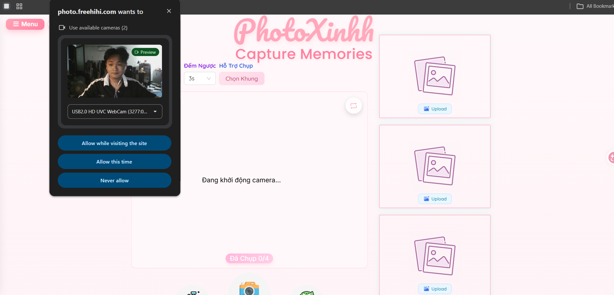
 
  * **Caption:** Upon launching the camera studio, the browser triggers the standard HTML5 `getUserMedia` permission dialog, requesting access to the device's webcam/camera while displaying an initialization status.

* **Screen 3: Layout Selection & Camera Error State (Aspect Ratio Configuration)**
  
  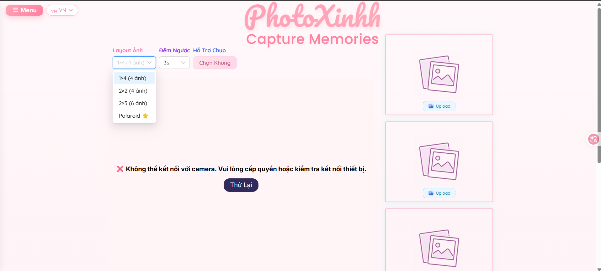
  
  * **Caption:** Users can select their desired photo arrangement from a dropdown menu (1x4 strip, 2x2 grid, 2x3 grid, or Polaroid format). If camera access fails, an error message with a retry prompt is shown while retaining optional manual photo upload placeholders on the right side.

* **Screen 4: Live Camera Studio & Studio Controls**
  
  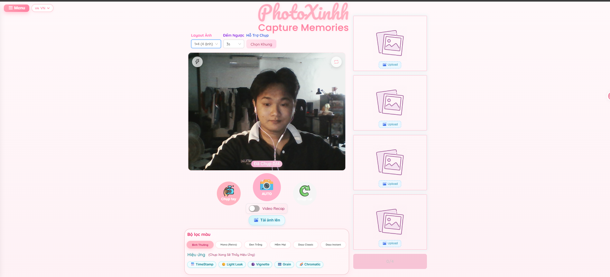
 
  * **Caption:** This screen shows the live camera preview with core photobooth controls, including countdown duration selection (3s), flash toggle, mirror mode switch, auto/manual capture modes, and real-time color filter presets.

* **Screen 5: Burst Capture Progress & Retake Mechanism**
  
  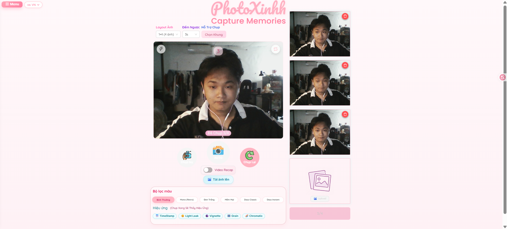
  
  * **Caption:** As the burst capture runs, captured photos are progressively rendered into the right-side layout preview. Each individual shot includes a delete/retake button, allowing users to recapture unsatisfactory frames before proceeding to decoration.

* **Screen 6: Frame Customization, Strip Preview & Export**
  
  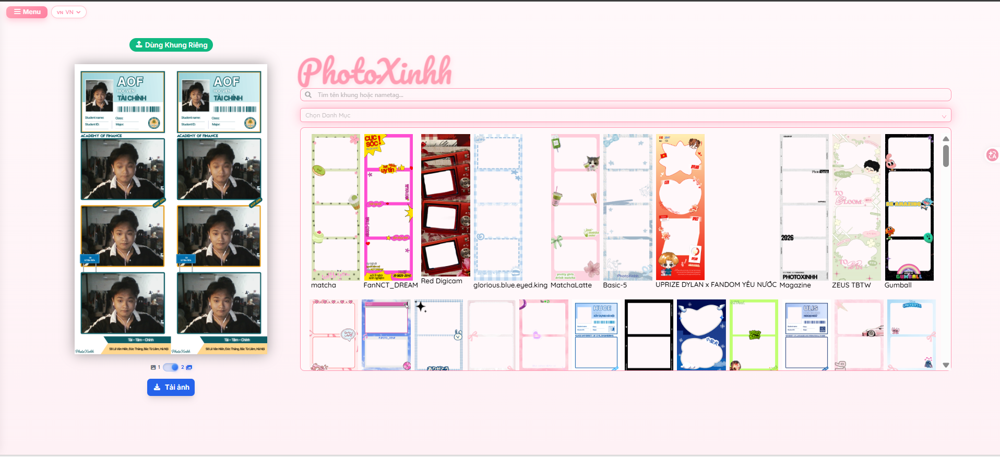
  
  * **Caption:** After all shots are completed, the composite photo strip is rendered on the left canvas, and users can browse a thematic frame library (categorized by tags and search bar) to apply custom borders. A "Tải ảnh" (Download Photo) button allows users to export the final high-resolution strip directly to their local storage.

---

#### 1.2. Kululu (`https://kululu.com`)

**Overview:** Kululu is a digital event photo-sharing platform designed for weddings, parties, and corporate events. It allows event hosts to set up a digital space, generate dynamic QR codes, and collect real-time photo uploads from attendees into a live interactive photo wall without requiring guests to install an app or create an account.

* **Screen 1: Landing Page & Value Proposition**
  
  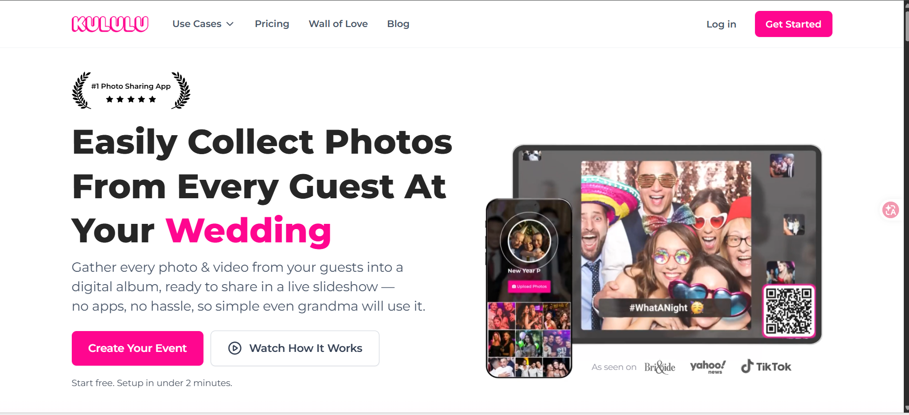
  
  * **Caption:** The landing page presents the platform's core premise: collecting guest photos into a digital album and live slideshow with zero app installation barriers. It provides direct "Create Your Event" and "Get Started" buttons to guide event organizers into the setup wizard.

* **Screen 2: Host Authentication & Account Access**
  
  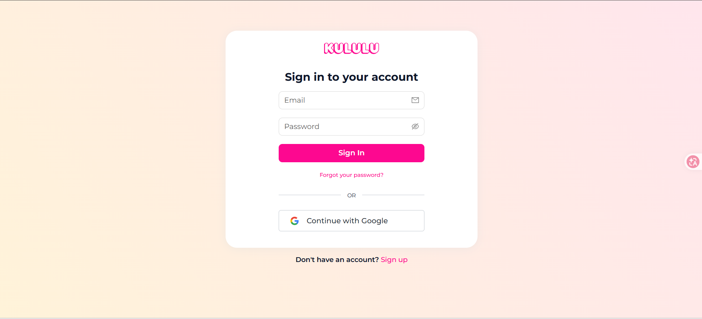
  
  * **Caption:** This screen shows the Host sign-in portal supporting traditional email/password credentials alongside one-click Google OAuth authentication, securing host events and administrative permissions.

* **Screen 3: Event Category & Context Selection**
  
  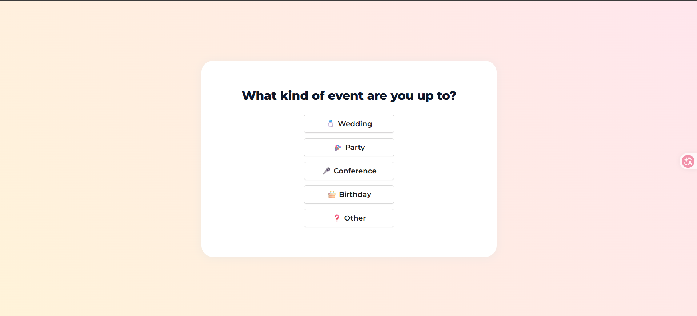
  
  * **Caption:** During initial event onboarding, hosts specify the occasion type (Wedding, Party, Conference, Birthday, or Other). This configuration tailors the event theme and session settings to the specific gathering.

* **Screen 4: Event Setup Wizard & QR Code Display**
  
  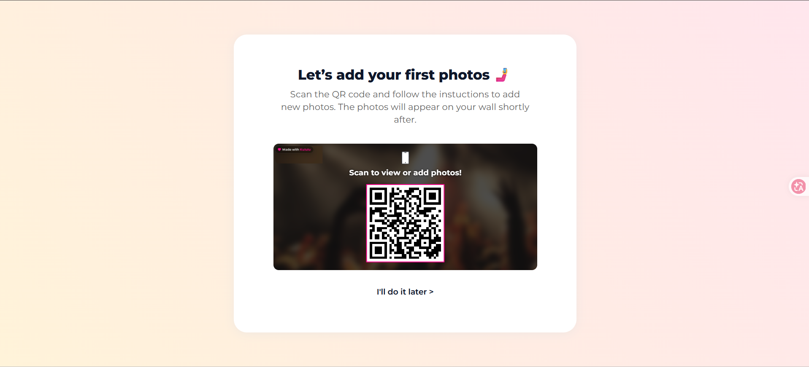
  
  * **Caption:** Once the event space is initialized, the system automatically generates an event-specific QR code on the desktop interface, prompting the host to scan or distribute it to test photo contributions.

* **Screen 5: Guest Mobile Capture & Upload Interface**
  
  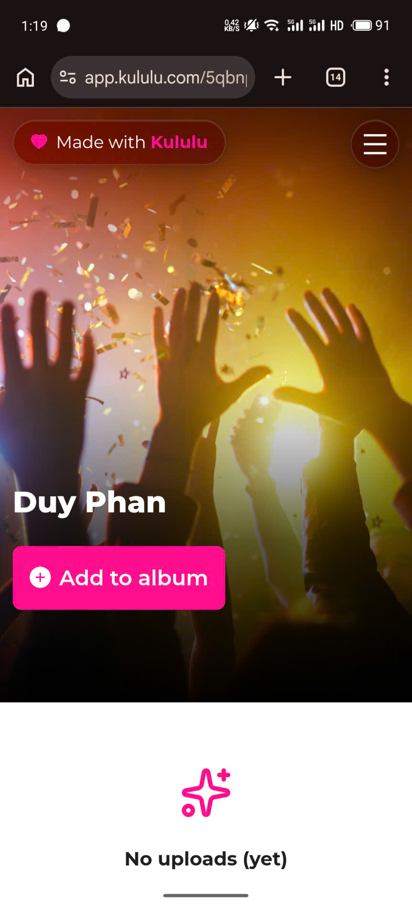
  
  * **Caption:** This mobile browser interface represents the attendee view immediately after scanning the event QR code. Without requiring any registration, guests see the event title and tap a prominent "+ Add to album" button to upload or capture photos directly from their smartphone.

* **Screen 6: Photo Submission Confirmation & Success Feedback**

  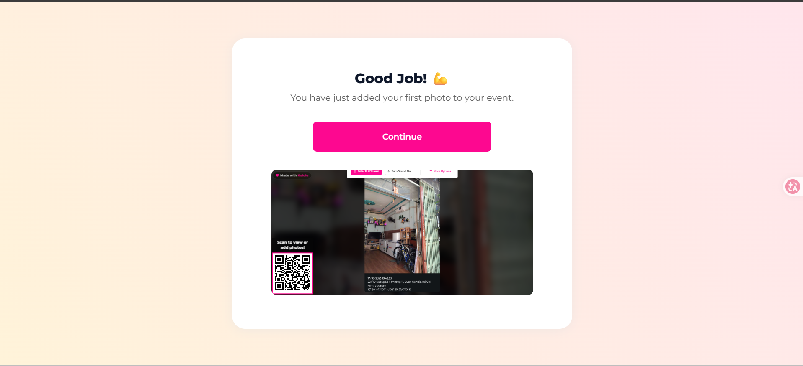
  
  * **Caption:** After an attendee submits a snapshot, a visual confirmation screen ("Good Job!") provides instant feedback and previews how the new image appears on the event's central photo stream.

* **Screen 7: Host Management Dashboard & Live Photo Wall**

  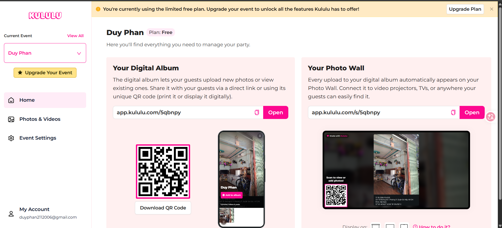

  * **Caption:** The host dashboard provides centralized control over the digital album link, printable QR code download, event settings, and the live "Photo Wall" designed for venue projectors and smart displays.

---

### 2. Comparison Summary

Based on our survey of existing solutions (*PhotoXinhh* and *Kululu*), we summarize their commonalities, our differentiation strategy for **SnapBooth**, and the UI/UX patterns we plan to adopt:

#### 2.1. What features these existing apps have in common

* **Zero-Installation Browser Execution:** Both platforms operate entirely within modern web browsers, eliminating the need for attendees to download or install native mobile applications.

* **Instant Visual Feedback:** Both provide immediate visual gratification for user actions, whether it is instantly rendering a multi-shot photo strip on an editing canvas (*PhotoXinhh*) or updating a live digital photo wall with a newly uploaded picture (*Kululu*).

* **Simplified User Workflows:** Both platforms aim to minimize user friction by providing straightforward, accessible interfaces focused on a single primary task (capturing photos or sharing photos).

#### 2.2. What your proposed app will do differently or better

* **Unified Experience (Interactive Photobooth + Shared Event Album):** Current solutions are fragmented. *PhotoXinhh* offers a great multi-shot capture and canvas editing experience but isolates users without any collective event context. Conversely, *Kululu* excels at aggregating event photos via QR codes into a shared gallery but only supports basic camera uploads without in-browser multi-shot countdowns or sticker/frame decorations. **SnapBooth** seamlessly merges these capabilities, allowing guests to capture multi-shot strips, decorate them, and instantly contribute to a live shared event album.

* **AI Concept Advisor (via Groq API):** Existing photobooth apps require users to manually scroll through dozens of frames and sticker packs. SnapBooth introduces a conversational AI assistant. Hosts or Guests can simply describe the event's theme (e.g., *"Vintage outdoor wedding"*), and the AI will automatically recommend and apply a cohesive set of frames, color filters, and stickers.

* **Comprehensive Host Moderation:** SnapBooth will implement a structured role-based system (Host, Guest, Admin). Event Hosts will have dedicated moderation controls to approve or reject guest photos before they are displayed on the public event gallery, ensuring content safety during live events.

#### 2.3. Which UI/UX patterns you plan to adopt from these apps

* **From PhotoXinhh:** We will adopt the intuitive, step-by-step studio workflow (*Layout Selection => 3-2-1 Countdown Capture => Canvas Editor for Stickers/Frames*) alongside the real-time camera preview layout.

* **From Kululu:** We will adopt the frictionless QR code onboarding pattern, allowing guests to scan a code and instantly enter the event space without facing a registration wall. We will also adopt the "Live Photo Wall" masonry grid layout for the shared event album display.

---

## D - Team Contract

### 1. Team Roles and Responsibilities

**Performed by:** Nguyễn Minh Hoàng | **Reviewed by:** Phạm Nguyễn Thanh Tùng | **Edited by:** Nguyễn Minh Hoàng

All team members are responsible for contributing to the complete software development lifecycle, including requirements analysis, design, implementation, testing, integration, and documentation. Each member has a primary role to establish clear ownership and accountability, but these roles do not restrict members from contributing to other areas of the project.

#### 1.1. Primary Roles

| Team Member | Primary Role | Responsibilities |
|---|---|---|
| Member 1: Phạm Nguyễn Thanh Tùng | Project Manager / Scrum Master + Full-Stack | Coordinate the team, organize Scrum meetings, manage sprint planning, track tasks and deadlines, monitor progress, and maintain project management documentation. As a full-stack developer, contribute to project setup (frontend/backend initialization), develop core UI layouts, and support system integration.|
| Member 2: Trần Quang Minh | Frontend Lead + Full-Stack | Define frontend architecture and UI conventions, lead interface development, implement the host and admin dashboards, review frontend and backend code, and coordinate API integration. |
| Member 3: Phạm Lâm Quyền | Backend Developer | Develop backend APIs, manage database queries and migrations, implement business logic for user authentication, event sessions, photo storage, and moderation features. |
| Member 4: Phan Ngọc Duy | Backend Lead + AI | Design APIs and database structures, implement authentication, authorization, event management, album services, and moderation logic, and develop the AI Concept Advisor using the Groq API. |
| Member 5: Nguyễn Minh Hoàng | Full-Stack Developer | Develop and integrate frontend and backend modules, support sticker and asset management, contribute to event album functionality, and assist with integration testing and deployment. |


#### 1.2. Shared Responsibilities

All members agree to:

-   Participate in requirements analysis, system design, implementation, and testing.

-   Contribute to frontend and backend development as required by the team's workload.

-   Create and update assigned tasks in the project management tool.

-   Participate in required Scrum meetings and report progress and blockers.

-   Review relevant code and documentation produced by other members.

-   Maintain clear communication and share technical knowledge.

-   Provide evidence of individual contributions through task history, commits, pull requests, and completed deliverables.

---

### 2. Communication Plan

**Performed by:** Phạm Nguyễn Thanh Tùng, Phạm Lâm Quyền | **Reviewed by:** All members | **Edited by:** Phạm Nguyễn Thanh Tùng

#### 2.1. Communication Tools

The team will use the following tools:

-   **Zalo, Discord, Google Meet:** Daily communication, online discussions, announcements, and coordination.

-   **Jira :** Task assignment, sprint planning, progress tracking, and deadline management.

-   **GitHub:** Source code collaboration, pull requests, issue tracking, and version-controlled documentation.

-   **Moodle:** Course-related announcements and assignment submissions.

#### 2.2. Meetings

The team will follow the Scrum process required by the course. Each sprint will include:

-   One Sprint Planning meeting to define sprint goals and assign tasks.

-   Two Scrum meetings distributed throughout the sprint to review progress and identify blockers.

-   One Sprint Review meeting to demonstrate completed work and evaluate sprint outcomes.

Additional meetings may be arranged when major technical issues or
integration problems arise.

#### 2.3. Communication Rules

-   Members should respond to project-related messages within 24 hours unless they have communicated their unavailability.

-   Members must inform the team as early as possible about blockers, absences, or potential delays.

-   Meeting decisions and action items must be recorded in a shared project channel or document.

-   Members should communicate respectfully and provide constructive feedback.

-   Technical discussions affecting multiple modules must be shared with the relevant team members before implementation.

---

### 3. Work Schedule and Deadlines

**Performed by:** Phạm Nguyễn Thanh Tùng, Nguyễn Minh Hoàng | **Reviewed by:** All members | **Edited by:** Phạm Lâm Quyền

#### 3.1. Task Planning

-   The team will organize work into sprints according to the course schedule.

-   Every project-related task, including coding, testing, documentation, and self-training, must be recorded in Jira or the agreed task management tool.

-   Each task must be assigned to exactly one responsible team member.

-   Each task must include a description, creation date, assignment date, expected deadline, and completion date.

-   Tasks must be created and assigned before work begins.

-   Each task should include clear acceptance criteria so that completion can be evaluated objectively.

#### 3.2. Project Milestones

The team will organize its work around the following general milestones:

1.  **Requirements and Planning:** Define stakeholders, user requirements, functional groups, and project scope.

2.  **System Design:** Prepare architecture diagrams, database design, API specifications, and UI/UX prototypes.

3.  **Core Development:** Implement authentication, event management, guest access, camera capture, and album functionality.

4.  **Advanced Features and Integration:** Implement photo editing, asset management, sharing, moderation, and AI Concept Advisor.

5.  **Testing and Deployment:** Conduct functional and integration testing, resolve defects, and deploy the application.

6.  **Documentation and Review:** Finalize project documentation, evaluate deliverables, and prepare demonstrations.

Exact dates and sprint assignments will be agreed upon during Sprint
Planning and recorded in the project management tool.

#### 3.3. Delays and Contingency Plans

-   Members must notify the team leader when a task is at risk of missing its deadline.
-   The responsible member should explain the blocker and propose a realistic recovery plan.
-   The team will evaluate workload redistribution or additional assistance when necessary.
-   If a delay affects the sprint goal, the team will prioritize essential functionality and discuss scope adjustments.
-   Any changes to agreed deadlines or task ownership must be recorded in the task management tool.

---

### 4. Code and Documentation Standards

**Performed by:** Phạm Nguyễn Thanh Tùng, Phan Ngọc Duy | **Reviewed by:** All members | **Edited by:** Phạm Nguyễn Thanh Tùng, Phan Ngọc Duy

#### 4.1. Coding Standards

-   Members must follow the team's agreed naming conventions, code formatting rules, and project structure.

-   Functions and modules should have clear responsibilities and avoid unnecessary duplication.

-   Frontend and backend interfaces must follow agreed API contracts.

-   Input validation and appropriate authorization checks must be implemented for relevant operations.

-   Error handling should provide useful feedback without exposing sensitive system information.

-   Code should be readable, maintainable, and consistent with the existing codebase.

#### 4.2. Git and Code Review

-   The team will store source code and documentation in a private GitHub repository.

-   Members should create feature branches for individual tasks and use meaningful commit messages.

-   Changes should be submitted through pull requests for review before merging into the main branch whenever practical.

-   At least one other team member should review significant code changes.

-   Developers must test their changes and resolve critical defects before merging.

-   API keys, passwords, access tokens, and other secrets must never be committed to the repository.

#### 4.3. Testing Standards

-   Each developer is responsible for testing the functionality they implement.

-   The team will perform integration testing across frontend, backend, database, and external services.

-   Important SnapBooth workflows must be tested, including event creation, QR-based guest access, camera capture, photo editing, album management, and sharing.

-   Authentication, role-based authorization, and moderation operations must be tested for appropriate access restrictions.

-   The AI Concept Advisor must be tested with valid prompts, incomplete descriptions, unexpected responses, and API failures.

-   Defects must be recorded, prioritized, and tracked until they are resolved or explicitly deferred.

#### 4.4. Documentation Standards

-   Project documents and reports must be written in English using Markdown.

-   Mermaid syntax should be used for diagrams whenever possible.

-   Documentation must be stored alongside the source code in the GitHub repository.

-   Each report or document section must identify the person who performed the work, reviewed it, and edited it.

-   Documentation must be updated when important requirements, designs, APIs, or implementation decisions change.

---

### 5. Accountability and Performance

**Performed by:** All members | **Reviewed by:** All members | **Edited by:** All members

#### 5.1. Performance Criteria

Individual contributions will be evaluated based on:

-   Completion and quality of assigned tasks.
-   Adherence to agreed deadlines.
-   Code quality, testing, and documentation.
-   Participation in meetings and project discussions.
-   Communication, collaboration, and responsiveness.
-   Evidence of actual contributions through Jira or Trello, Git history, pull requests, and deliverables.

#### 5.2. Handling Underperformance

-   Members should raise difficulties early and request support when necessary.

-   If a member repeatedly misses deadlines or fails to complete assigned tasks, the team leader will discuss the issue privately with that member.

-   The member and team leader will agree on corrective actions and a reasonable recovery timeline.

-   If the problem persists, the team may redistribute tasks and document the changes.

-   Persistent or serious issues that cannot be resolved internally may be escalated to the teaching assistant or instructor.

#### 5.3. Commitment to Fair Contribution

-   Every member is expected to make a meaningful contribution to the project.

-   Members must not claim work that they have not completed.

-   Task reassignment and changes in responsibility must be recorded.

-   The team will use documented evidence rather than assumptions when evaluating individual contributions.

---

### 6. Decision-Making Process

**Performed by:** All members | **Reviewed by:** All members | **Edited by:** All members

-   The team will seek consensus for important decisions involving requirements, architecture, UI/UX, APIs, and project scope.

-   If consensus cannot be reached after discussion, the team will use a majority vote.

-   Each team member has one vote.

-   The Project Manager / Scrum Master facilitates the discussion and records the final decision.

-   Technical decisions must consider maintainability, feasibility, security, and the project's learning objectives.

-   Decisions affecting multiple modules must be discussed with the relevant module owners.

-   Decisions affecting agreed requirements, sprint goals, or deadlines must be communicated to the entire team.

---

### 7. Conflict Resolution

**Performed by:** All members | **Reviewed by:** All members | **Edited by:** All members

The team agrees to resolve disagreements through the following process:


1.  **Direct Discussion:** The involved members discuss the issue respectfully and attempt to reach a mutually acceptable solution.

2.  **Team Leader Facilitation:** If the issue remains unresolved, the Project Manager / Scrum Master facilitates a discussion to clarify responsibilities and possible solutions.

3.  **Team Decision:** If necessary, the team evaluates the availableoptions and makes a decision using the agreed decision-making process.

4.  **Escalation:** If the conflict continues to affect project progress, the team may seek guidance from the teaching assistant or instructor.

5.  **Documentation:** Important resolutions and resulting action items must be recorded when relevant.

All members must focus on resolving the issue constructively and avoid personal attacks or inappropriate behavior.

---

### 8. Review and Update Process

**Performed by:** All members | **Reviewed by:** All members | **Edited by:** Nguyễn Minh Hoàng

-   The team will review this contract at the beginning of each sprint or whenever significant changes occur.

-   Any member may propose changes to improve the team's workflow or address new circumstances.

-   Proposed changes must be discussed and approved by the team.

-   Approved updates must be recorded in the Markdown document and committed to the GitHub repository.

-   The team will review role assignments, communication practices, deadlines, and accountability procedures when necessary.

-   All members are expected to follow the latest agreed version of the contract.

---

### Team Agreement

By confirming this contract, all team members agree to follow the established working practices, fulfill their responsibilities, communicate transparently, and contribute to the successful development of SnapBooth.

  
| Team Member | Student ID | Confirmation / Date |
|---|---|---|
| Member 1: Phạm Lâm Quyền | 24127116 | Agreed / 22/10/2026 |
| Member 2: Nguyễn Minh Hoàng | 24127172 | Agreed / 22/10/2026 |
| Member 3: Phạm Nguyễn Thanh Tùng | 24127260 | Agreed / 22/10/2026 |
| Member 4: Phan Ngọc Duy | 24127354 | Agreed / 22/10/2026 |
| Member 5: Trần Quang Minh | 24127452 | Agreed / 22/10/2026 |

---

## E - Development Tools and Process Setup

**Performed by:** Phạm Lâm Quyền, Phạm Nguyễn Thanh Tùng | **Reviewed by:** Phạm Nguyễn Thanh Tùng | **Edited by:** Phạm Lâm Quyền, Phạm Nguyễn Thanh Tùng

### 1. Development Process (Scrum Methodology)

Our team adopts the Scrum framework to manage the SnapBooth project. Each Project Assignment (PA) corresponds to one Sprint spanning 2–3 weeks.

- **Sprint 1 (PA1) Goal:** Set up project infrastructure, finalize the project proposal, conduct market research on existing apps, and establish collaboration workflows.

- **Scrum Meetings:**
  - **Sprint Planning:** Conducted at the start of Sprint 1 to define tasks (SB-1 to SB-10) and assign a single owner to each task.

  - **Daily Scrum (2 sessions):** Held mid-sprint to review progress on Markdown documentation and resolve blockers.

  - **Sprint Review & Retrospective:** Scheduled before submission to review deliverables and evaluate teamwork efficiency.

### 2. Tools & Environment Setup

We have configured the following tools for seamless team collaboration:

- **Moodle and Discord (`#snapbooth-dev`):** Used for tracking official course announcements and team discussions.

- **Communication Tool:** A Box Messenger group named `SE02` was created for daily interactions and quick technical discussions.

- **Task Management (Jira):** Configured a Scrum board at [phamlamquyen1707.atlassian.net](https://phamlamquyen1707.atlassian.net). Every sub-task (SB-1 to SB-10) is assigned to exactly one member, with creation, assignment, and completion dates recorded.

- **Version Control (Git & GitHub):** A private repository was initialized with a standard folder structure, including `/src`, `/docs`, and `/docs/management`. API keys are protected using `.gitignore`.

- **AI Coding Platforms:** All five team members have registered for educational AI coding accounts.

- **Spec Kit Adoption Plan:** The team plans to adopt Spec Kit starting from PA2 to support specification-driven development.

### 3. Jira Task Management Evidence

The following screenshots provide evidence of our Jira Scrum Board and backlog, including all ten tasks (SB-1 to SB-10).

#### 3.1. Scrum Board


*Figure 1. SnapBooth Sprint 1 Scrum Board showing task distribution across To Do, In Progress, and Done.*

#### 3.2. Backlog - Tasks SB-1 to SB-10

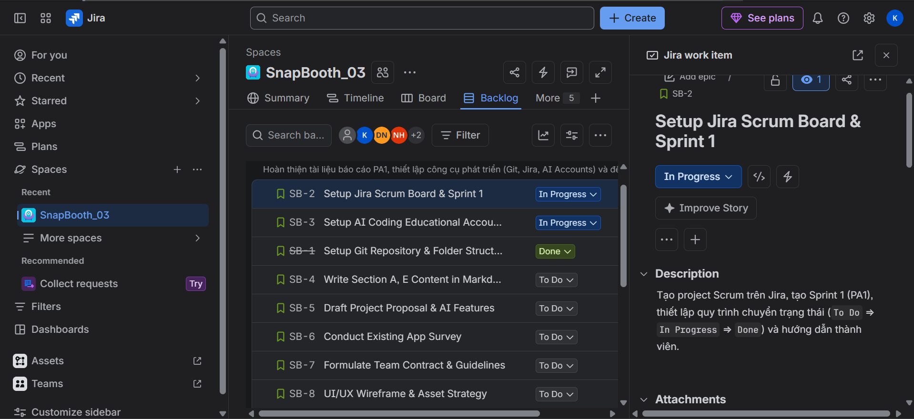


*Figure 2. Jira backlog showing the tasks from SB-1 to SB-10.*

### 4. Git Repository Structure & Commit Log

The private repository follows the required course standards and uses the following folder structure:

```text
SnapBooth/
├── src/
├── docs/
│   ├── management/
│   │   ├── PA1
│   │   │   ├── images/
│   │   │   ├── PA1-Group03.md
│   │   │   └── PA1-Group03.pdf
│   │   └── weekly-reports/
│   ├── requirements/
│   ├── analysis-and-design/
│   └── test/
└── .gitignore
```

The `.gitignore` file prevents sensitive information, such as API keys, from being committed to the repository.

### 5. AI Coding Accounts Evidence

Each team member is required to register for a free educational account on an AI coding platform, such as GitHub Copilot for Students or Cursor, in accordance with the course curriculum. The following screenshots provide evidence of account registration for all five team members.

#### 5.1. Hoang

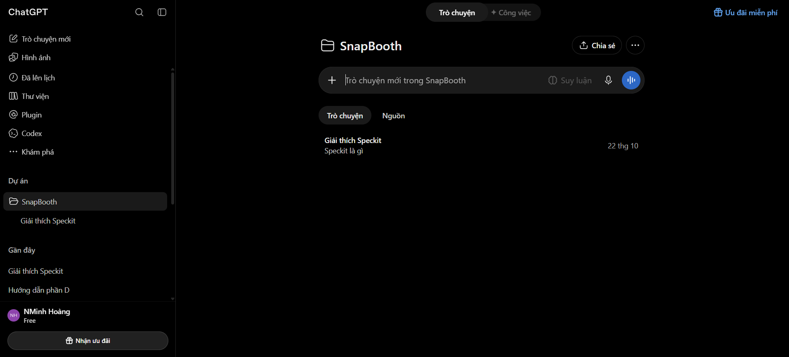

#### 5.2. Tung

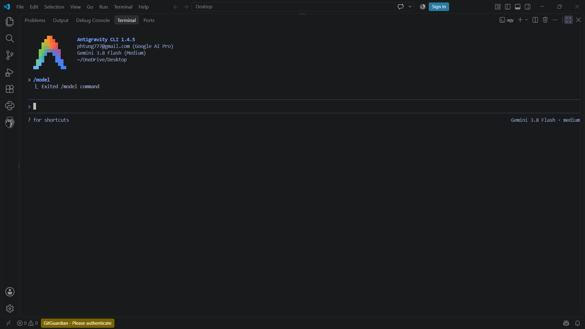

#### 5.3. Quyen


#### 5.4. Duy

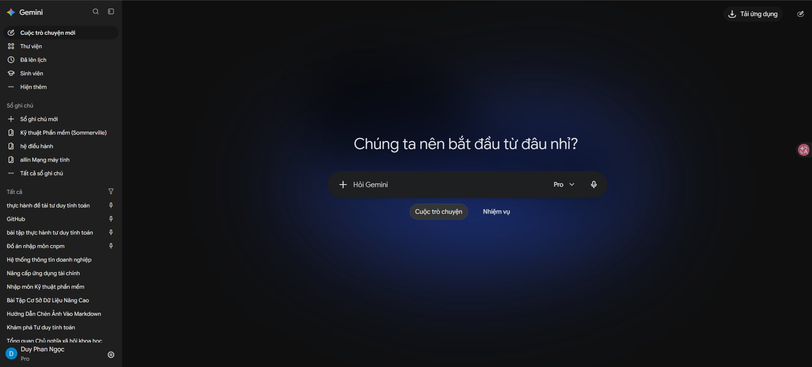

#### 5.5. Minh

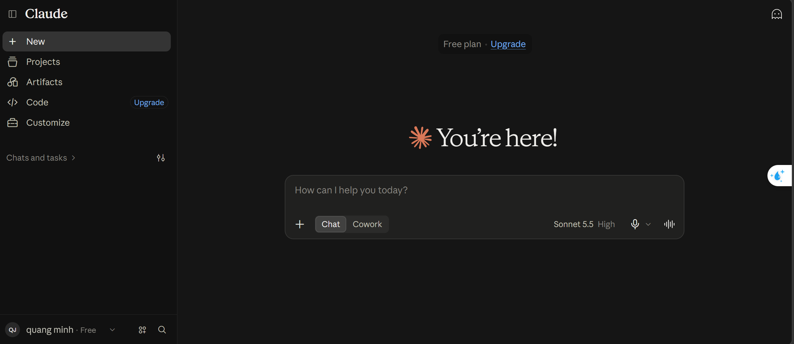
